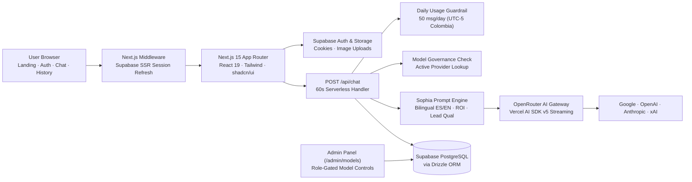
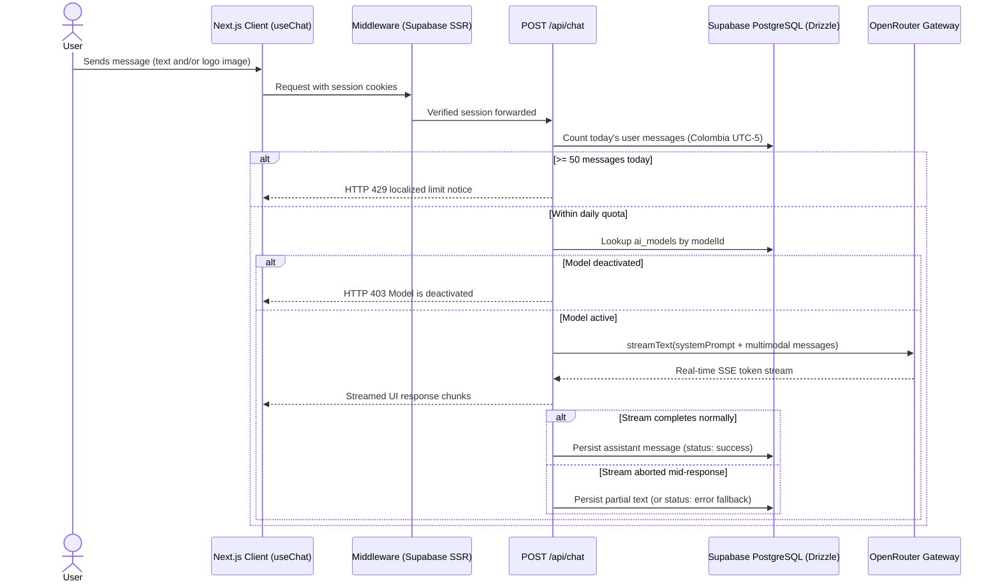
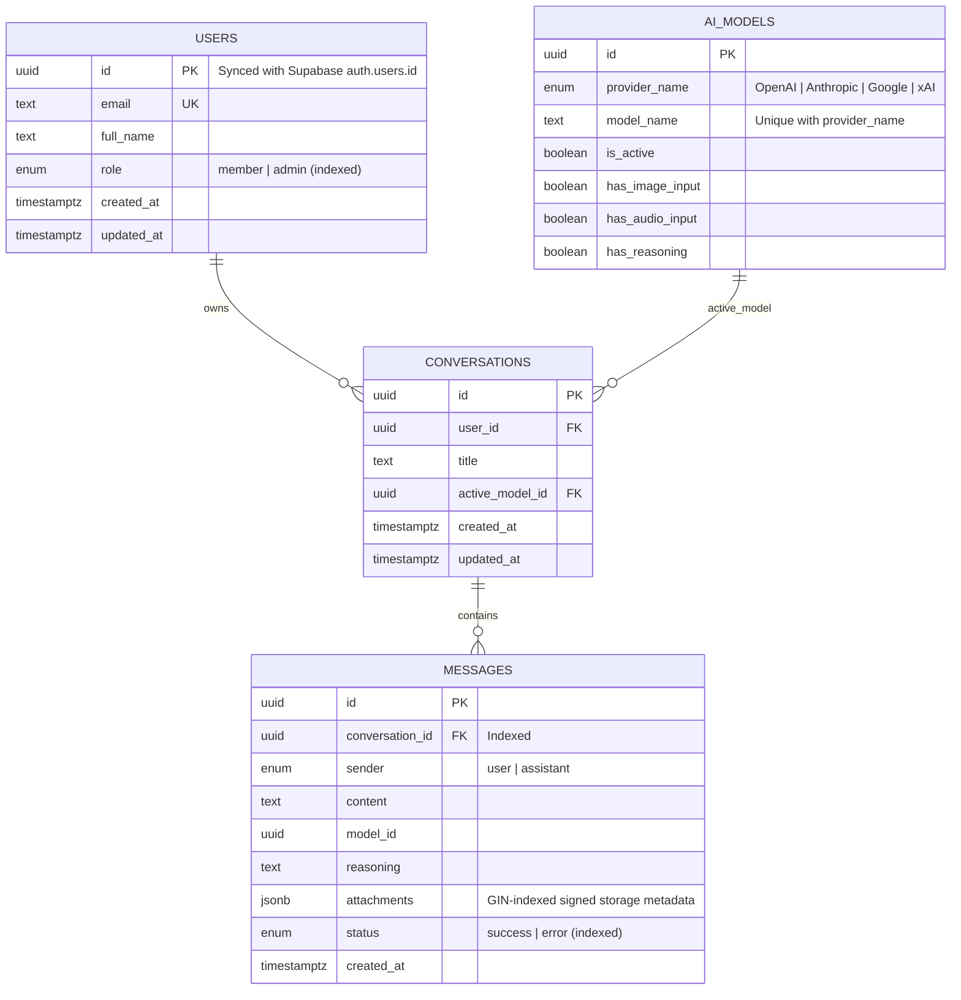

# Sophia — Bilingual Gen-AI Business Mentor

> **Portfolio Case Study by Wilson Cely (`@grogngy`)** · Production-ready bilingual Generative AI mentor designed, customized, and launched for **IdentIA Lab** (Colombia) using **AI-assisted development** and the **ShipKit `chat-simple`** low-code framework.

---

## My Role & How This Was Built

I built **Sophia** as an **AI Solution Builder & Product Architect** using an **AI-assisted, low-code / template-driven workflow** on top of the **ShipKit `chat-simple` framework** (Next.js + Supabase + Drizzle ORM + OpenRouter). Rather than hand-coding full-stack boilerplate from scratch, I leveraged ShipKit and AI coding tools to move rapidly from concept to a production-ready MVP — focusing directly on product strategy, bilingual prompt architecture, usage/cost guardrails, cloud wiring, QA, and launch operations.

| Area | What I Directly Designed & Delivered | ShipKit Foundation (Template Layer) |
| :--- | :--- | :--- |
| **AI & Prompt Design** | Bilingual (`ES / EN`) consultative persona, language-detection check, time-based ROI framework, progressive lead qualification, and MVP boundary guardrails ([`route.ts`](app/api/chat/route.ts)) | Vercel AI SDK v5 streaming plumbing & OpenRouter provider integration |
| **Product & Localization** | IdentIA Lab brand identity, LATAM Spanish landing copy, chat welcome flow, business-focused prompt examples, and QA/component tracking | Next.js 15 App Router scaffold, Tailwind CSS, and shadcn/ui component library |
| **Cost & Usage Controls** | 50-message/day quota (resetting at Colombia midnight UTC-5), model-selection strategy (Gemini Flash Lite / Flash / GPT-4o Mini), and admin model toggles | Supabase Auth, PostgreSQL schema boilerplate, and Drizzle ORM migration runner |
| **Cloud & Production Ops** | End-to-end Supabase, OpenRouter, and Vercel configuration, env security, user-sync recovery ([`production-fix.sql`](production-fix.sql)), and conversation-export workflows | Base deployment guides and template scripts |

---

## System Architecture



---

## End-to-End Request & Streaming Data Flow

Every chat turn passes through authentication, timezone-aware rate limiting, model governance, real-time token streaming, and abort-safe persistence:



---

## Database Schema (PostgreSQL + Drizzle ORM)

Schema definitions live in [`lib/drizzle/schema/`](lib/drizzle/schema/) with indexed foreign keys, role-based access control, JSONB attachment storage (GIN-indexed), and message status tracking for error recovery:



---

## Production-Readiness Standards

Even without an active public demo URL, this repository is structured for immediate production deployment on Vercel + Supabase:

| Production Pillar | Implementation in This Repo | Verification Path |
| :--- | :--- | :--- |
| **Bilingual Guardrails & Lead Qualification** | Mandatory English-detection check, Colombian/LATAM Spanish persona, time-only ROI templates (no unverified pricing), proactive 40-message warning, and natural email capture after high-intent signals | [`app/api/chat/route.ts`](app/api/chat/route.ts) |
| **Daily Rate Limiting** | Server-side 50-message/day cap computed in Colombia time (`UTC-5`) via an indexed Drizzle join — no extra quota tables needed, and fails safely on transient DB errors | [`lib/usage-counter.ts`](lib/usage-counter.ts) |
| **Streaming Resilience & Error Mapping** | Saves partial assistant responses if a user cancels mid-stream (`onFinish` abort handler) and maps OpenRouter `401`, `403` (BYOK), `404`, and `429` errors into clean HTTP responses | [`app/api/chat/route.ts`](app/api/chat/route.ts) |
| **Typed Environment & Secret Isolation** | Runtime Zod schema via `@t3-oss/env-nextjs` ensures misconfigured deployments fail fast; Supabase and OpenRouter keys stay strictly server-only | [`lib/env.ts`](lib/env.ts), [`.env.local.example`](.env.local.example) |
| **Auth, RBAC & Route Boundaries** | Supabase SSR session middleware with fail-open fallback, `member`/`admin` roles guarding `/admin/*`, plus dedicated `error.tsx`, `loading.tsx`, `not-found.tsx`, and `/unauthorized` pages | [`middleware.ts`](middleware.ts), [`app/(protected)/`](app/(protected)/) |
| **Database Operations & Recovery** | Separate local and `:prod` npm scripts for Drizzle migrations, rollbacks, migration status, seeding, storage setup, auth-to-public user reconciliation, and conversation export | [`package.json`](package.json), [`scripts/`](scripts/), [`production-fix.sql`](production-fix.sql) |
| **Regional Legal & Privacy Pages** | Geolocation-aware legal wrapper covering Terms, Cookies, and LATAM/GDPR privacy rights | [`lib/geolocation.ts`](lib/geolocation.ts), [`app/(public)/privacy/`](app/(public)/privacy/) |

---

## Tech Stack

| Layer | Technologies |
| :--- | :--- |
| **Framework Foundation** | ShipKit `chat-simple` template (AI-assisted / low-code accelerator) |
| **Frontend** | Next.js 15 (App Router, Turbopack), React 19, TypeScript, Tailwind CSS, shadcn/ui, Framer Motion |
| **AI & Streaming** | Vercel AI SDK (`ai` v5), `@ai-sdk/react`, `@openrouter/ai-sdk-provider` |
| **Backend & Auth** | Supabase Auth (`@supabase/ssr`), PostgreSQL, Supabase Storage |
| **Data & Validation** | Drizzle ORM, `drizzle-kit`, Zod, `@t3-oss/env-nextjs` |

---

## Local Quick Start (For Reviewers)

Anyone reviewing this repository can deploy or run Sophia locally in ~5 minutes using free-tier Supabase and OpenRouter accounts.

### 1. Clone, Install & Configure

```bash
git clone https://github.com/grogngy/sophia-chat.git
cd sophia-chat
npm install
cp .env.local.example .env.local
```

Populate `.env.local` (git-ignored — never commit secrets):

| Variable | Scope | Description |
| :--- | :--- | :--- |
| `DATABASE_URL` | Server | Supabase PostgreSQL connection string |
| `SUPABASE_URL` | Server | Supabase project URL |
| `SUPABASE_ANON_KEY` | Server | Supabase anon/public key |
| `SUPABASE_SERVICE_ROLE_KEY` | Server | Supabase service role key (server-only) |
| `OPENROUTER_API_KEY` | Server | OpenRouter API key for multi-model inference |
| `NEXT_PUBLIC_APP_URL` | Client | App base URL (e.g., `http://localhost:3000`) |
| `NEXT_PUBLIC_COMPANY_WEBSITE` | Client | Organization or portfolio website URL |
| `NEXT_PUBLIC_COMPANY_WHATSAPP` | Client | Contact WhatsApp number (international format) |
| `NEXT_PUBLIC_COMPANY_EMAIL` | Client | Contact email address |

### 2. Initialize Database & Run

```bash
npm run db:migrate
npm run db:seed
npm run storage:setup
npm run dev
```

Open [http://localhost:3000](http://localhost:3000). To deploy to production on Vercel, connect this repository, add the same 9 environment variables in Vercel Project Settings, and run the `:prod` database scripts (`db:migrate:prod`, `storage:setup:prod`).

---

## Security & Attribution

- **Strict secret isolation:** All credentials live in git-ignored `.env.local` / `.env.prod` files and are validated at startup in [`lib/env.ts`](lib/env.ts); Supabase keys have no `NEXT_PUBLIC_` browser exposure.
- **Attribution:** Built by **Wilson Cely (`@grogngy`)** for **IdentIA Lab** (Colombia) using the **ShipKit `chat-simple`** framework and AI-assisted development workflows. Company credentials, private brand assets, and live production data are excluded from this personal portfolio repository.
