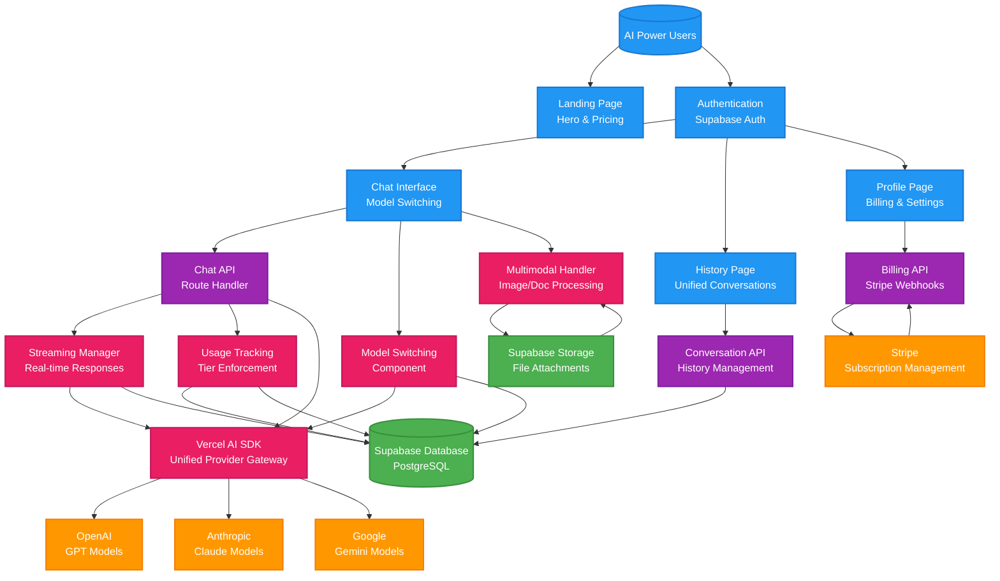

## System Architecture Blueprint

### App Summary
**End Goal:** Help AI power users achieve seamless and flexible access to multiple AI models within a single chat interface using Vercel AI SDK-powered model integration
**Template Foundation:** chat-saas template with Next.js, Supabase (auth/database/storage), Tailwind CSS, and Stripe billing infrastructure
**Core Features:** Unified AI model switching between OpenAI/Anthropic/Google, conversation history preservation across models, multimodal support, subscription tier management

---

## 🏗️ System Architecture

### Architecture Diagram

### System Flow Explanation

**User Journey**
AI power users access the platform through the landing page, authenticate via Supabase Auth, and primarily interact through the Chat Interface where they can seamlessly switch between AI models. They manage conversation history through the History page and handle billing/settings through the Profile page.

**Data Flow**
User messages flow from Chat Interface → Chat API → Model Switching Component → Vercel AI SDK → Selected AI Provider. Responses stream back through the same path while Usage Tracker records consumption and Streaming Manager handles real-time delivery. All conversations and messages persist to Supabase Database with model attribution preserved.

**Key Integrations**
- **Supabase Auth** provides secure user authentication and session management
- **Vercel AI SDK** serves as unified gateway to OpenAI, Anthropic, and Google AI providers
- **Stripe** handles subscription lifecycle, billing webhooks, and tier enforcement
- **Supabase Storage** manages multimodal file attachments (images, documents)

**Custom Components**
- **Model Switching Component** enables seamless provider changes within conversations
- **Usage Tracking System** enforces tier limits and monitors consumption patterns
- **Streaming Manager** handles real-time AI responses with proper interruption controls
- **Multimodal Handler** processes image and document uploads for AI analysis

---

## ⚠️ Technical Risk Assessment

### ✅ Low Risk (Template Handled)
- User authentication and session management (Supabase Auth)
- Database operations and connection pooling (Supabase PostgreSQL)
- Payment processing and webhook handling (Stripe integration)
- File storage and CDN delivery (Supabase Storage)
- Basic conversation and message persistence (existing schema)

### ⚠️ Medium Risk (Monitor These)
- **AI Provider Cost Management** - Different pricing models across OpenAI, Anthropic, Google
- **Multimodal File Processing** - Ensuring images/documents don't impact chat performance
- **Model Availability Management** - Graceful handling of provider outages or deprecations

### 🔴 High Priority (Address Early)
- **Database Schema Updates** - Fix subscription tier enums from [free, basic, pro] to [free, pro, premium]
- **Model Access Control** - Update ai_models table to support 3-tier access (free/pro/premium models)

---

## 🏗️ Implementation Considerations

### Required Architectural Components
- **Model Switching Component** with database-driven configuration and real-time state management
- **Vercel AI SDK Integration** as unified provider gateway with error handling and streaming support
- **Usage Tracking System** with tier-based enforcement and consumption monitoring
- **Enhanced Streaming Manager** with proper interruption controls for model switching
- **Database Schema Migrations** to align subscription tiers and model access control

### Optional System Enhancements
- **Advanced Usage Analytics** with detailed consumption reporting and cost optimization insights
- **Model Performance Monitoring** with provider availability tracking and automatic failover
- **Enhanced Admin Dashboard** with advanced model management and user analytics
- **Conversation Export System** with PDF/Markdown export and model attribution

### Database Architecture Changes
- Update `users.subscription_tier` enum from ["free", "basic", "pro"] to ["free", "pro", "premium"]
- Modify `ai_models.is_premium_model` to `access_tier` enum supporting ["free", "pro", "premium"]
- Ensure existing conversation and message tracking supports model attribution
- Verify usage tracking tables align with new subscription tier structure

### External Service Integration
- **Vercel AI SDK** as primary integration point for OpenAI, Anthropic, and Google providers
- **Stripe** for subscription management, billing webhooks, and tier enforcement
- **Supabase Storage** for multimodal file handling with async processing
- **Individual AI APIs** as fallback options for advanced features if needed

### Performance & Scaling Architecture
- Database indexing on conversation and message queries with model filtering
- Efficient streaming architecture with proper memory management for long conversations
- Usage tracking optimization to prevent blocking legitimate user interactions
- File processing pipeline that maintains responsive chat interface performance

---

## 🛠️ Implementation Strategy

### Phase 1 (MVP Foundation)
- **Database Schema Updates**: Fix subscription tier enums and model access control
- **Model Switching Component**: Core architecture for seamless provider switching within conversations
- **Vercel AI SDK Integration**: Unified gateway setup for OpenAI, Anthropic, and Google providers
- **Usage Tracking System**: Tier-based consumption monitoring and enforcement logic
- **Streaming Manager**: Real-time response handling with proper interruption controls
- **Basic Multimodal Support**: Image and document upload through Supabase Storage

### Phase 2 (Enhanced Features)
- **Advanced Usage Analytics**: Detailed consumption reporting and cost optimization insights
- **Enhanced Multimodal Processing**: Advanced document analysis and image processing workflows
- **Model Performance Monitoring**: Provider availability tracking and automatic failover logic
- **Conversation Export System**: PDF and Markdown export functionality with model attribution
- **Admin Dashboard Enhancements**: Advanced model management and user analytics

### Architecture Guidelines
- **Template Foundation**: Leverage existing chat-saas authentication, billing, and conversation management - don't rebuild these systems
- **Custom Development**: Focus development effort on Model Switching Component and Vercel AI SDK integration - these are your unique differentiators
- **Integration Strategy**: Start with Vercel AI SDK as primary integration point, add individual provider fallbacks only if needed for advanced features
- **Data Flow Priority**: Ensure model attribution is captured at every message level for accurate usage tracking and conversation restoration
- **Performance Approach**: Keep model switching instant by maintaining conversation state in database, not in memory

---

## 🎯 Success Metrics

This system architecture supports your core value proposition: **Seamless and flexible access to multiple AI models within a single chat interface**

**MVP Success:** Your architecture will support seamless model switching, unified conversation history across providers, multimodal support, and subscription tier management
**Scalability Ready:** System can grow to support advanced analytics, conversation templates, API access, and voice capabilities
**Template Optimized:** Leverages existing chat-saas foundation while enabling your unique AI model switching vision

> **Next Steps:** Ready for implementation with this complete system architecture blueprint
